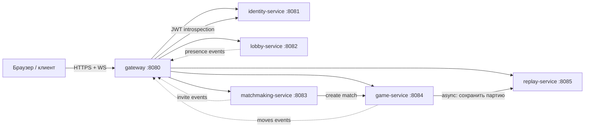

# Бэкенд игры «Дурак» — микросервисы и OpenAPI

Оригинальный `DurakSharpServer` (папка `DurakDotnet/`) — это один TCP-сервер,
который делает всё сразу:

- регистрирует клиентов по имени (ID = SHA-256 от IP-адреса);
- раз в секунду рассылает список online-игроков;
- пересылает пакеты между клиентами (`GO?`, `GO!`, `NO!`);
- пересылает состояние партии (`PLAYER0/PLAYER1/DECK`) и ходы
  (`CARD:x;STACK:y`, `MOVE`, `GRAB`, `WIN`);
- сохраняет повторы (`.dr`) и отдаёт их список/содержимое.

Ниже этот монолит разложен на микросервисы. Для каждого сервиса лежит
OpenAPI-спецификация в этой папке.

## Состав сервисов

| Сервис | Порт (dev) | Ответственность | Спецификация |
|---|---|---|---|
| **identity-service** | 8081 | Аккаунты игроков, выдача JWT, профили | [`identity-service.yaml`](auth-service.yaml) |
| **lobby-service** | 8082 | Presence (кто онлайн), сердцебиение, список игроков | [`lobby-service.yaml`](lobby-service.yaml) |
| **matchmaking-service** | 8083 | Приглашения, принятие/отказ, создание матча | [`matchmaking-service.yaml`](matchmaking-service.yaml) |
| **game-service** | 8084 | Партии: раздача, проверка и применение ходов, результат | [`game-service.yaml`](game-service.yaml) |
| **replay-service** | 8085 | Хранение и выдача повторов партий | [`replay-service.yaml`](replay-service.yaml) |
| **gateway** | 8080 | Единая точка входа (BFF), агрегация REST + WebSocket | [`gateway.yaml`](gateway.yaml) |



## Поток данных в партии

1. Клиент логинится в **identity-service** → получает `playerId` и JWT.
2. Подключается к **gateway** по WebSocket и открывает сессию в **lobby-service**
   (периодический `heartbeat`).
3. Игрок A отправляет приглашение игроку B через **matchmaking-service**
   (`POST /invites`). Игроку B приходит событие `invite.created`.
4. B принимает (`POST /invites/{id}/accept`) → **matchmaking-service** создаёт
   матч и просит **game-service** создать партию с раздачей.
5. Ходы идут через `POST /games/{id}/moves`. **game-service** — авторитетный:
   проверяет правила и рассылает новое состояние/события `game.updated`.
6. По завершении **game-service** отправляет партию в **replay-service**.
7. Повторы читаются через `GET /replays` и `GET /replays/{id}`.

## Realtime (WebSocket)

Realtime-каналы gateway (описаны как справочные события, не через OpenAPI):

- `lobby.players` — список online-игроков (аналог `SERVER:CLIENTS`);
- `invite.created` / `invite.accepted` / `invite.declined` — приглашения
  (аналог `GO?` / `GO!` / `NO!`);
- `game.state` / `game.move` / `game.finished` — состояние и ходы партии
  (аналог `PLAYER0:...DECK:...`, `CARD:x;STACK:y`, `MOVE`, `GRAB`, `WIN`);
- `presence.online` / `presence.offline`.

## Формат карты

Совпадает с оригиналом, чтобы клиент и реплеи были совместимы:

- `suit`: `0` — бубен, `1` — пик, `2` — червей, `3` — крестей;
- `power`: `6..14` (6,7,8,9,10,В=11,Д=12,К=13,А=14).

Строковый формат карты для повторов: `"suit,power;"`.

## Как поднять спеки

```bash
# Просмотр через Swagger UI / Redoc
npx @redocly/cli preview-docs backend/openapi/replay-service.yaml
# или
docker run -p 8080:8080 -v $PWD/backend/openapi:/spec redocly/cli preview-docs /spec/game-service.yaml
```
